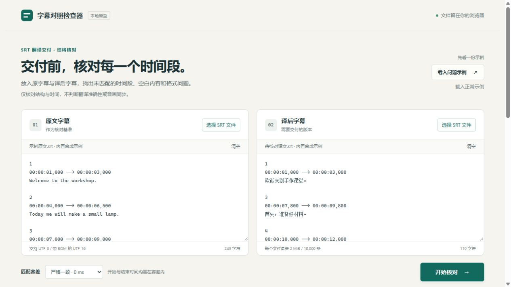

# 字幕对照检查器 · SRT Pair Check

早期原型 v0.1.0。用原文 SRT 和译文 SRT 核对时间段、空白正文与文件结构，帮助交付前发现需要人工查看的差异。



## 直接使用

1. 下载并解压发布包，找到 `index.html`，用较新的 Chrome 或 Edge 打开。
2. 首次点“载入问题示例”会自动检查，看看它怎样提示少一段、改时间、空正文。
3. 分别选择自己的原文、译文 SRT，或将文本粘贴到两侧，再检查。
4. 查看问题对应的段落与时间，必要时下载报告。

无需账号、安装程序、API 密钥或运行服务器。页面没有外部字体、统计脚本和网络请求；选择的文件在浏览器内处理。原文件不会被改写。导出的报告包含字幕正文，请按你自己的分享范围保管。

## 它检查什么

- 原文时间区间在译文中是否有唯一对应；译文是否出现未对应的区间。
- 空正文、时间格式错误、结束不晚于开始、缺少块分隔。
- 重复编号、重复时间段、倒序和重叠等需要核对的情况。
- 可选的毫秒容差，并明确记录容差内的时间变化。

**“未找到对应时间段”不等于“漏译”。** 合并、拆分、改时也会产生差异。本工具不读取音频，不评价翻译意思、流畅度或字幕同步；结构一致也不能证明翻译准确。重叠有时是合理安排，只提示，不修复。

## 匹配方式与边界

首先匹配双方唯一且完全相同的起止时间。启用容差时，只有两个方向都只有一个候选才匹配。重复或多候选标为待核对；不会为了凑齐数量强行配对。编号只作显示和提醒，不作为匹配依据。

默认容差为 0 毫秒，可以按项目需要选择 50、100、250 毫秒。这是使用者设置，不是任何平台的官方交付标准。

- 当前只支持常见文本 SRT。时间格式为 `00:00:01,000 --> 00:00:02,000`，兼容小数点但会提示。
- 文件支持严格 UTF-8，以及带 BOM 的 UTF-16 LE/BE。其他编码请先另存为 UTF-8；不会静默忽略乱码。
- 每个文件不超过 2 MiB，每份最多 10,000 个非空字幕块。
- 字幕块用空行分隔。含定位扩展的时间行、ASS/WebVTT、字幕正文内部刻意使用空白段落等格式尚未覆盖。
- 极密集的容差候选达到计算上限时，会明确报“未完成”，可以改用 0 毫秒或拆分文件。
- 为保证页面响应，报告列表可能只显示前一部分；导出的完整报告保留所有结果。

修改输入后，需要重新检查才能导出当前结果。报告中的“匹配”只指时间结构对应。

## 示例

`examples/source.srt` 是四段英文原文；`good.srt` 保持原时间并使用中文译文；`bad.srt` 刻意缺少第二段、改动第三段时间，第四段为空。它们是自编合成示例，没有使用影视作品字幕。

## 验证与开发

核心检查没有第三方依赖。开发者安装 Node.js 18 或以上后可运行：

```text
node --test tests/core.test.js
node verification/real-subtitles/verify.cjs
```

测试覆盖删除后重编号、相同条数下的改时、合并拆分、容差歧义、重复时间、坏格式、空正文、中文与换行、上万段输入等实际误判风险。浏览器验证情况见同目录 `VALIDATION.md`。

文件分工：`core.js` 为纯检查逻辑，`app.js` 为界面和文件读取，`styles.css` 为样式。项目由刘汉谋发起，AI 辅助研究与实现，目前没有真实用户采用数据。欢迎通过 Issues 提交可复现的问题；请使用可公开的最小示例，不要上传私密字幕。

## English

A browser-local, read-only comparison of source and translated SRT files. Open `index.html`, select or paste two files, and inspect timing/structure differences. No backend, API key, or network dependency. Matching uses unique time intervals, never sequence numbers alone. It does not assess translation quality or audio synchronization. This is an early prototype, not a platform compliance checker.

代码采用 MIT License。`verification/real-subtitles/` 中的第三方字幕及其改编测试副本采用 CC BY 3.0，署名与来源见该目录的 `ATTRIBUTION.md`。

2026-10-25 补充：已用 Blender 开放电影的真实中英字幕完成文件选择、检查、导出流程，并通过 8 项额外验收。结果、原始素材、人工修改记录和已知限制见 `verification/real-subtitles/真实字幕验收.md`。
